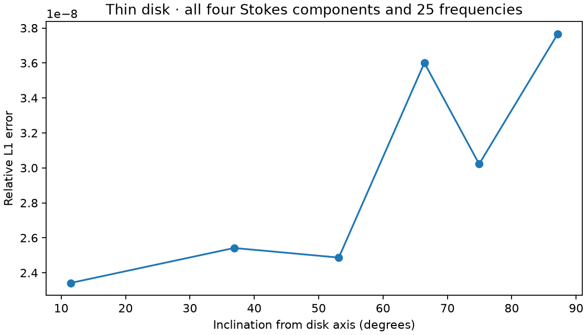
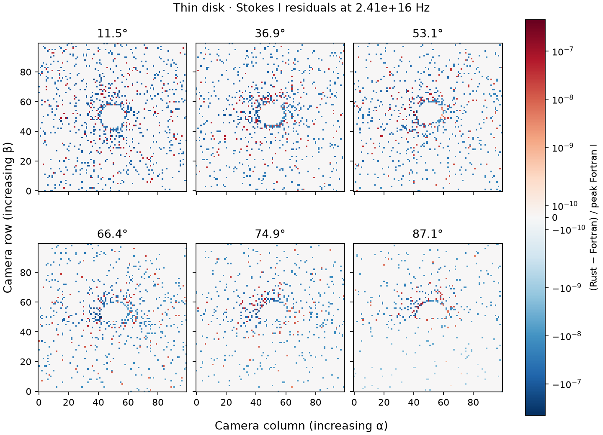

# Thin-disk residuals across viewing angles

How closely do the Rust and Fortran images agree as the disk approaches edge-on? We ran both executables with the bundled THINDISK deck at six inclinations from 11.5° to 87.1°. Only the observer inclination changed. The disk, spin, camera grid (100 × 100), emissivity (BBPOL) and 25 frequencies stayed fixed.

The aggregate relative error ranged from 2.34 × 10⁻⁸ to 3.77 × 10⁻⁸. For each inclination we summed the absolute Rust–Fortran differences over all pixels, four Stokes components and frequencies, then divided by the corresponding sum of absolute Fortran values. This measures implementation agreement for this disk model. Agreement can persist if both solvers share the same error.



The maps show the signed Stokes I difference at 2.41 × 10¹⁶ Hz. Each panel uses the peak Fortran intensity at its own inclination for normalization and shares a symmetric logarithmic color scale with the other panels. Across the six maps, the largest absolute pixel difference was 4.49 × 10⁻⁷ of the peak intensity, at 53.1°. This normalization keeps faint pixels from dominating the display. It does not measure the fractional error relative to each pixel's own intensity.



[Full numerical results](inclinations.csv)

## Reproduce the sweep

These measurements used Rust revision `87e726e` (rustc 1.100.0, release build) and [upstream Fortran revision c76cb11](https://github.com/jadexter/grtrans/tree/c76cb11fa1396516f38ba6f972c68fbb5b5ae984) (GNU Fortran 14.2, Linux x86-64, CFITSIO 4.6.2). The repo's compatibility patch reorders namelist declarations for the Fortran compiler. At the fixture inclination of 74.93°, Rust differed from the freshly built Fortran by 3.02 × 10⁻⁸. Against the archived reference array the Rust error was 1.14 × 10⁻⁷. The archive came from an earlier macOS build.

From the Rust repository root, with stable Rust, Git, GNU Fortran, make, the CFITSIO development library and Python with numpy, matplotlib and astropy installed, run the following in Bash. Change the CFITSIO library directory for your system.

```bash
upstream=$(mktemp -d)/grtrans
git clone https://github.com/jadexter/grtrans "$upstream"
git -C "$upstream" checkout c76cb11fa1396516f38ba6f972c68fbb5b5ae984
git -C "$upstream" apply "$PWD/reference/upstream/gfortran15.patch"
cp reference/upstream/Makefile.top "$upstream/Makefile.top"
make -C "$upstream" grtrans GRTRANSDIR="$upstream" CFITSIODIR=/usr/lib/x86_64-linux-gnu
cargo build --locked --release -p grtrans
python scripts/compare_thindisk_inclinations.py "$upstream/grtrans" target/release/grtrans target/tilt-study
```

Supply a fresh output directory for each run. It retains both solvers' input files, logs and FITS files for every inclination, along with the CSV and both plots.
